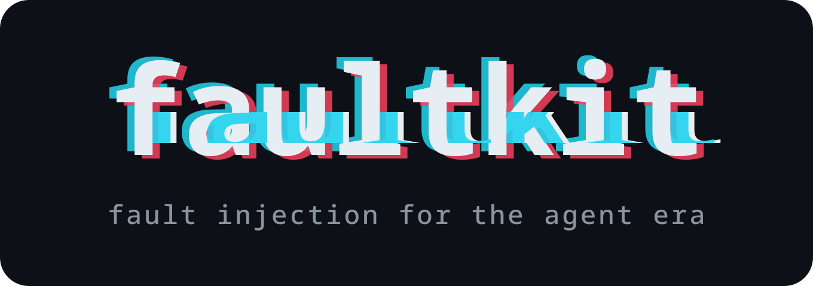

<div align="center">



### Run the error handlers you've never run.

**Fault injection for the agent era. One binary. Zero dependencies.**

[](LICENSE)
[](https://faultkit.dev)

[Install](#install) · [Coding agents](#from-your-coding-agent) · [60-second demo](#60-second-demo) · [Scenarios](#scenarios) · [How it works](#how-it-works) · [Docs](https://faultkit.dev/#docs)


<sub>A real Claude Code session (Fable 5.1) with the [faultkit skill](#from-your-coding-agent) on a helpdesk triage agent: `/faultkit:values` → `/faultkit:review` → `/faultkit:prove-all` → `/faultkit:harden` → `/faultkit:prove-all`. Waits are cut: about ten minutes of work in 1:42. The agent under test runs on a local mock model; faultkit injects the faults.</sub>

</div>

> **Status:** v0.1 — LLM, Anthropic-specific, Bedrock-specific, and syscall-level scenarios run end-to-end.
> **Platforms:** macOS and Linux for HTTP scenarios. Linux 5.8+ (x86-64) for syscall-level scenarios.

---

## Your agent's error handling has never run

Your agent chains LLM calls, tool subprocesses, RAG lookups, HTTP requests. One flaky link anywhere in that chain silently corrupts the entire reasoning loop — and you find out in production.

The retry logic for a `429` from OpenAI mid-chain. The cleanup when a tool subprocess gets `SIGPIPE`'d. The fallback when your vector DB returns shuffled results. **You wrote that code. You've never seen it run.**

faultkit triggers the failures your agents hit in production, so you can fix them before your users do.

---

## From your coding agent

faultkit ships a skill for coding agents, so the agent that writes your code
can also prove that it fails safely. In Claude Code:

```text
/plugin marketplace add faultkit/skills
/plugin install faultkit@faultkit
```

The skill runs the faultkit you have installed, 0.1.3 or later (see
[Install](#install)), and never downloads or builds it. If faultkit isn't
installed, proving stops and prints the install commands.

| Command | What it does |
|---|---|
| `/faultkit:values` | Writes `.faultkit/values.md` from your words: the business value and the outcomes that must never happen. Review, `/faultkit:prove-all`, and CI then report which outcomes are covered. |
| `/faultkit:review` | Maps your action boundaries and counts the business invariants a fault can prove. Changes no code. |
| `/faultkit:prove-all` | Proves every invariant under fault and reports one proof state per invariant. |
| `/faultkit:harden` | Adds the smallest guard at the boundary, proves it again, and asks before opening a pull request. |
| `/faultkit:prove` | Proves one invariant, e.g. `/faultkit:prove a paid invoice is never sent to collections -- pytest -q`. |
| `/faultkit:run` | The same as `/faultkit:prove-all`. |

A session on [incident-response-agent](https://github.com/faultkit/incident-response-agent),
a sample on-call agent in Python + LangChain that you can try it on. One
outcome goes in by hand, review finds three more in the code, and the first
proof shows that all four fail silently:

```text
> /faultkit:values Customers can always check out, and when they can't, a person is on it within minutes. A real outage must never be closed as a false alarm without paging anyone.
- UO-1: A real outage is closed as a false alarm without paging anyone.

> /faultkit:review
Outcomes: 1 declared, 1 covered, 3 proposed. Invariants: 4 found, 4 provable with faultkit.

> /faultkit:values
- UO-2: A real outage ends with nobody paged.
- UO-3: Customers aren't told checkout is down, and the responder reports that they were.
- UO-4: A healthy deploy is rolled back.

> /faultkit:prove-all
=== prove-all ===
invariant                        fired  exit  proof state
no-false-alarm-without-metrics       3     1  silent failure confirmed
outage-always-reaches-a-person       1     1  silent failure confirmed
status-page-failure-is-reported      1     1  silent failure confirmed
rollback-only-newest-deploy         15     1  silent failure confirmed

> /faultkit:harden
Invariants: 4 found, 4 not yet guarded.

> /faultkit:prove-all
=== prove-all ===
invariant                        fired  exit  proof state
no-false-alarm-without-metrics       6     0  invariant proven under fault
outage-always-reaches-a-person       1     0  invariant proven under fault
status-page-failure-is-reported      1     0  invariant proven under fault
rollback-only-newest-deploy         15     0  invariant proven under fault
=== outcomes ===
outcome  worst state                   invariants
UO-1     invariant proven under fault  no-false-alarm-without-metrics
UO-2     invariant proven under fault  outage-always-reaches-a-person
UO-3     invariant proven under fault  status-page-failure-is-reported
UO-4     invariant proven under fault  rollback-only-newest-deploy
declared 4, covered 4, uncovered 0, unlinked invariants 0
```

With your consent, every proven invariant is kept in `.faultkit/invariants/`:
one scenario per invariant and a `manifest.json` that names its gate test,
so CI replays the same proofs (see [CI integration](#ci-integration)).
Without it, the proof goes to a temporary workspace and your project is left
untouched.

The skill follows the [Agent Skills](https://agentskills.io) standard, so
agents that read `.agents/skills/` (Codex, Cursor, and others) can load it
too. Claude Code is the tested path so far. For installing it in other
agents, and the full reference, see [faultkit/skills](https://github.com/faultkit/skills).

---

## 60-second demo

The failure mode: your agent retries an OpenAI call after a `429`, but the retry uses partial reasoning state and produces a confidently wrong answer. You won't catch this in a unit test. You'll catch it in faultkit.

```bash
# Install (macOS / Linux)
curl -fsSL https://faultkit.dev/install.sh | sh

# Run your tests with 20% of OpenAI calls returning 429
faultkit run --scenario llm-api-degraded -- pytest tests/agent/
```

That's it. No mocks. No fixtures. Your agent code calls `api.openai.com` exactly the way it does in production — and faultkit returns a real HTTP 429 with a real `Retry-After` header, indistinguishable from the real thing.

```text
=== faultkit summary ===
scenario:     llm-api-degraded
target:       pytest tests/agent/
duration:     14.2s
faults fired: 7
target exit:  1 (FAIL)
```

A failing run you didn't have yesterday. A production bug you won't have tomorrow.

---

## Scenarios

faultkit ships scenarios mapped to real production failure modes. Each one targets a layer in the agent stack where errors actually originate.

### LLM and gateway

These are **failure modes** — provider-agnostic recipes. By default each fires
against every provider that has a fixture for it: OpenAI, Anthropic, and
Bedrock, except `llm-streaming-cutoff`, whose `streaming-cutoff` mode has no
Bedrock fixture (OpenAI and Anthropic only). Narrow to one with `--provider`.
The `gateway-timeout` recipe is the exception: it targets your gateway's host.

| Scenario | What it does | Status |
|---|---|:---:|
| `llm-api-degraded` | Rate-limit requests to OpenAI and Anthropic (HTTP 429, `Retry-After: 30`) and Bedrock (HTTP 429 `ThrottlingException`) | ✅ |
| `malformed-json-response` | LLM returns 200 OK with syntactically invalid JSON in the body | ✅ |
| `malformed-tool-use` | Tool call with malformed / schema-violating arguments, breaking dispatch | ✅ |
| `max-tokens-truncation` | 200 with truncated content (`finish_reason: length` / `stop_reason: max_tokens`) an agent treats as complete | ✅ |
| `llm-streaming-cutoff` | Drop the SSE connection mid-stream after N (80) content deltas; fires only on streams that reach N | ✅ |
| `llm-empty-response` | 200 OK, valid JSON, but no content: `content: null` + `finish_reason: content_filter` (OpenAI), or an empty `content` array with `end_turn` (Anthropic, Bedrock). Applies to non-streaming calls | ✅ |
| `llm-slow-first-token` | Hold each request 8–15s, then forward it unchanged: the response (streamed or not) starts late | ✅ |
| `context-window-overflow` | The provider rejects the request as over the model's context window: HTTP 400 (OpenAI `context_length_exceeded`, Anthropic `prompt is too long`, Bedrock `ValidationException`). Not silent truncation | ✅ |
| `gateway-timeout` | Your LLM gateway answers 30 s late, or hangs 60 s and then returns 504. Forward-proxy mode only, via [copy-paste recipes](docs/scenarios.md#gateway-timeout); a gateway on `localhost` is reached only if your client sends loopback traffic through the proxy | ✅ |

### Anthropic-specific

Failure modes Claude surfaces that have no direct OpenAI equivalent, so they
ship as their own scenarios (Anthropic-only).

| Scenario | What it does | Status |
|---|---|:---:|
| `anthropic-overloaded` | HTTP 529 `overloaded_error` under heavy load | ✅ |
| `anthropic-stream-error` | SSE stream emits an `error` event mid-stream, no `message_stop` terminator | ✅ |
| `anthropic-tool-use-cutoff` | `tool_use` block truncated by `max_tokens` — an incomplete tool call | ✅ |
| `anthropic-refusal` | 200 with `stop_reason: "refusal"` — the model declined | ✅ |
| `anthropic-request-too-large` | HTTP 413 `request_too_large` for an oversized request | ✅ |

### Bedrock-specific

Amazon Bedrock failures with no cross-provider equivalent. Bedrock is
**forward-proxy only** — it authenticates with SigV4, which the proxy leaves
intact but base-URL mode would break, so `--base-url` doesn't target it.

| Scenario | What it does | Status |
|---|---|:---:|
| `bedrock-model-timeout` | HTTP 408 `ModelTimeoutException` — the model didn't respond in time | ✅ |
| `bedrock-service-unavailable` | HTTP 503 `ServiceUnavailableException` under load | ✅ |

### RAG and vector DB

| Scenario | What it does | Status |
|---|---|:---:|
| `rag-stale-results` | Pinecone / Qdrant Cloud query returns matches for nonexistent or deleted document ids (REST APIs, forward-proxy only; gRPC clients that honour the proxy fail to connect) | ✅ |
| `embeddings-degraded` | Embeddings endpoint returns 503 (OpenAI `/v1/embeddings`; Bedrock embedding models, forward-proxy only) | ✅ |

### Tool calls and subprocesses

| Scenario | What it does | Status |
|---|---|:---:|
| `tool-permission-denied` | `EACCES` when the agent opens a file or directory (`openat`) | ✅ |
| `tool-call-flaky` | Subprocess returns truncated stdout with exit 0 — agent reasons on partial data | 🛣️ |
| `partial-tool-result` | Tool returns a valid-but-incomplete result (half a JSON array), exit 0 | 🛣️ |
| `tool-slow` | Subprocess hangs for N seconds, exposes timeout-handling bugs | 🛣️ |

### Agent orchestration and MCP

| Scenario | What it does | Status |
|---|---|:---:|
| `mcp-tool-schema-mismatch` | An MCP server's `tools/call` result no longer matches the tool's declared `outputSchema`: each top-level `structuredContent` value changes type. Streamable-HTTP MCP servers in forward-proxy mode only (not stdio, not `--base-url`), and `structuredContent` only, not the text in `content[]`, via a [copy-paste recipe](docs/scenarios.md#mcp-tool-schema-mismatch) | ✅ |
| `subagent-timeout` | An HTTP call to a sub-agent (A2A, MCP over streamable HTTP, …) never returns within the run — tests the orchestration ceiling. HTTP sub-agents and forward-proxy mode only (not stdio MCP servers or subprocesses), via a [copy-paste recipe](docs/scenarios.md#subagent-timeout) | ✅ |
| `memory-write-failure` | An HTTP memory store acknowledges a write it never stores; the next read is stale. HTTP-backed stores and forward-proxy mode only, via a [copy-paste recipe](docs/scenarios.md#memory-write-failure) | ✅ |

### Backend classics

| Scenario | What it does | Status |
|---|---|:---:|
| `flaky-network` | Probabilistic `ECONNRESET` on `recvmsg` / `recvfrom` (Linux, syscall-level) | ✅ |
| `disk-full` | `ENOSPC` on write after N bytes | 🛣️ |
| `slow-dns` | 500–5000ms delay on resolution, intermittent `EAI_AGAIN` | 🛣️ |
| `fd-exhaustion` | `EMFILE` after N open descriptors | 🛣️ |

✅ = shipped · 🛣️ = planned

All scenarios are free and open source. Forever.

---

## How it works

You don't need to know this to use faultkit. But if you're going to run it in your CI, you'll want to.

faultkit picks the right injection mechanism for each scenario automatically. Two ship today, the HTTPS proxy (with its base-URL mode) and eBPF; an LD_PRELOAD shim is planned:

**HTTPS proxy.** For LLM / RAG / gateway scenarios. faultkit runs an in-process MITM proxy, terminates TLS with a CA it provisions for the target process only, and rewrites HTTP responses (status codes, bodies, streaming). The target sees a real HTTP 429 from a real TLS connection, because that's what it gets. Connections are served over HTTP/1.1 (HTTP/2 isn't proxied yet), which is transparent to virtually every HTTP client. Cross-platform, no privileges required.

This relies on the target trusting faultkit's per-run CA (it does — faultkit points the standard CA-bundle environment variables at it). The one thing it can't intercept is **certificate pinning**: a client that pins a specific certificate or public key, rather than trusting the system/injected CA bundle, will reject the proxy's leaf and the scenario won't fire. The mainstream LLM SDKs (OpenAI, Anthropic, and the like) don't pin, so this mostly affects hardened mobile or bespoke clients.

**Base-URL mode (`--base-url`).** Some clients ignore `HTTPS_PROXY` entirely — Node's global `fetch`/undici, and SDKs running inside a subprocess whose environment is filtered. For those, `faultkit run --base-url` points the SDK at faultkit directly by injecting the provider's base-URL variable (`OPENAI_BASE_URL`, `ANTHROPIC_BASE_URL`, …) instead of a proxy setting. The SDK connects to faultkit as if it were the API; faultkit synthesizes the fault or forwards to the real upstream. No proxy env to honor, no CA trust to arrange — which is what makes it work for the SDK-based clients that dominate agent code.

Either way, if *no* request actually reaches faultkit (the client ignored the proxy, or never used the base URL), the run warns loudly rather than passing silently — a green run that injected nothing is more dangerous than a red one.

**eBPF, Linux 5.8+.** For syscall-level scenarios — backend chaos, tool-call subprocess failures, file permission denials. faultkit attaches small eBPF programs to the relevant syscall kprobes (`recvmsg`, `recvfrom`, `openat`) and uses `bpf_override_return` to rewrite syscall return values for processes inside the target's PID tree. The target sees a real `ECONNRESET`, a real `EACCES`, because that's what the kernel returned.

**LD_PRELOAD shim (planned).** For the gap in between — dynamically linked targets where you want syscall-level fidelity without root, or you're on macOS (where `DYLD_INSERT_LIBRARIES` plays the same role). The planned shim is a small C library that interposes on libc functions. It doesn't ship yet.

Auto-mode is the default: a scenario with any HTTP experiment runs in proxy mode, and a syscall-only scenario runs in eBPF mode. Each run uses one mechanism, so in auto-mode a scenario that mixes the two runs only its HTTP experiments. Where eBPF isn't available (on macOS today, or on Linux without the kernel, architecture, or capabilities it needs), a syscall scenario fails with `eBPF mode is not available on this host` and exit code `2`. You can force a mode with `--mode=ebpf` / `--mode=proxy`, and add `--base-url` to make proxy mode inject base-URL env instead of `HTTPS_PROXY`.

Why more than one mechanism: the failures your agent hits in production *don't all live at the same layer*. An LLM 429 lives in HTTP semantics on top of TLS. A `SIGPIPE` on a tool subprocess lives at the pipe stdio layer. An `ENOSPC` lives at the filesystem syscall layer. A single-mechanism tool can fake the others, but the faked version exercises different code paths than the real one. faultkit gives you the real one.

---

## Authoring scenarios

Write a YAML file. faultkit handles the rest.

```yaml
# nightmare.yaml
name: nightmare
description: Two LLM providers failing in the same run.

experiments:
  - name: "OpenAI rate-limited mid-reasoning"
    fault:
      http_status: 429
      response_headers:
        Retry-After: "30"
    match:
      host: api.openai.com
    probability: 0.2

  - name: "Anthropic overloaded on the fallback"
    fault:
      http_status: 529
    match:
      host: api.anthropic.com
    probability: 0.1
```

Run it:

```bash
faultkit run --config nightmare.yaml -- go test ./...
```

A run uses one injection mechanism, so keep syscall experiments (`errno` +
`syscall`) in a scenario of their own. When a scenario mixes the two, auto-mode
runs only its HTTP experiments, and eBPF mode only ever runs a scenario's first
syscall experiment.

### Failure modes and providers

The builtin LLM scenarios above aren't written per-provider. They're **failure
modes** — provider-agnostic recipes whose concrete response shape comes from a
per-provider fixture. Name a mode and faultkit fans it out across every provider
that has a fixture for it:

```yaml
experiments:
  - name: rate-limited
    failure: rate-limited     # the failure mode
    probability: 0.2          # no `provider:` → fires for OpenAI, Anthropic, and Bedrock
```

Narrow it to one provider with the field, or the `--provider` flag at runtime:

```bash
faultkit run --scenario malformed-json-response --provider anthropic -- pytest tests/
```

Adding a new provider means adding a fixture, never a new scenario. faultkit
knows the LLM APIs OpenAI, Anthropic, and **Amazon Bedrock** (forward-proxy
only; its SigV4 auth survives the MITM proxy but rules out base-URL mode), and
the vector databases **Pinecone** and **Qdrant Cloud** (forward-proxy only, REST
APIs). Run `faultkit check` to see every registered provider and the modes it
fires. The raw `fault` + `match` form (above) still works for fully custom
scenarios.

Schema reference: [docs.faultkit.dev/scenarios](https://faultkit.dev/docs/scenarios).

---

## Install

**Quick install**

```bash
# macOS, Linux
curl -fsSL https://faultkit.dev/install.sh | sh
```

The script installs the release for your platform into `~/.local/bin`
without sudo. It refuses a tarball that doesn't match the release's
`checksums.txt`, and with cosign installed it first verifies that file's
signature (see **Verify a release** below). Set `FAULTKIT_VERSION` to pin a
release or `FAULTKIT_INSTALL_DIR` to install elsewhere. Read it first at
<https://faultkit.dev/install.sh>.

**From a release**

```bash
# Resolve the latest version, then download + extract for your platform.
# Platforms: linux_amd64 · linux_arm64 · darwin_amd64 · darwin_arm64
VERSION=$(curl -fsSL https://api.github.com/repos/faultkit/faultkit/releases/latest \
  | grep -m1 '"tag_name"' | cut -d'"' -f4)
curl -fsSL "https://github.com/faultkit/faultkit/releases/download/$VERSION/faultkit_${VERSION#v}_linux_amd64.tar.gz" \
  | tar -xz faultkit
sudo mv faultkit /usr/local/bin/faultkit
```

**Package managers**

```bash
brew install faultkit/tap/faultkit   # macOS / Linux (Homebrew)
yay -S faultkit-bin                   # Arch (AUR)
go install github.com/faultkit/faultkit/cmd/faultkit@latest
```

**Verify a release**

Starting with v0.1.3, every release's `checksums.txt` is signed keyless with
[Sigstore cosign](https://docs.sigstore.dev/); the signature bundle ships
next to it as `checksums.txt.sigstore.json`. The Homebrew formula and the
AUR package pin the sha256 values from that signed file. To check a
downloaded tarball yourself (cosign v2.4+):

```bash
cosign verify-blob \
  --bundle checksums.txt.sigstore.json \
  --certificate-identity cenk.kalpakoglu@gmail.com \
  --certificate-oidc-issuer https://accounts.google.com \
  checksums.txt
sha256sum --ignore-missing -c checksums.txt   # macOS: shasum -a 256 --ignore-missing -c
```

**Requirements**

- **Proxy-mode scenarios**: any platform with a working Go runtime. No privileges.
- **eBPF-mode scenarios**: Linux 5.8+ on x86-64, with BTF and
  `CONFIG_BPF_KPROBE_OVERRIDE` enabled. (The BPF programs hook `__x64_sys_*`
  kprobes and use `bpf_override_return`, which needs that kernel config —
  most distro kernels have it, some minimal/cloud kernels don't. arm64
  isn't supported yet.) The simplest path is `sudo`:

  ```
  sudo faultkit run --scenario flaky-network -- ./your-target
  ```

  The file-capabilities path also works and avoids running the target
  as root. faultkit needs three capabilities:

  ```
  sudo setcap 'cap_bpf,cap_net_admin,cap_perfmon=+ep' /usr/local/bin/faultkit
  ```

  - `cap_bpf` + `cap_net_admin` — load BPF programs and attach the kprobes.
  - `cap_perfmon` — kernel requires it for tracing-class BPF programs (kprobes, tracepoints).

  No `cap_sys_ptrace` is needed: at load time faultkit briefly raises its
  own `dumpable` flag via `prctl(PR_SET_DUMPABLE, 1)` so cilium/ebpf can
  read `/proc/self/mem` for kernel/BTF detection, then restores it. The
  trade-off is a short window during load where another process running as
  your user could ptrace-attach to faultkit. faultkit is a developer tool —
  that's acceptable on a developer machine or single-tenant CI runner. If
  it's not, use `sudo` instead.

**Process-tree propagation works through wrappers.** faultkit registers
the PID it forks; descendants inherit the registration automatically,
so `sh -c '... curl ...'` and similar wrappers fire faults on the
inner process the same as a direct invocation.

**Heads-up on Go targets**: Go's `net/http` reads via `read()` rather
than `recvmsg()`/`recvfrom()`. faultkit's kprobes only cover the
latter two, so libc-based clients (most C/Python/Node tooling) get
faulted but Go HTTP targets don't. Use the proxy scenarios for Go
targets.

Run `faultkit check` after install — it tells you which modes are available on your machine and why.

---

## CI integration

Drop it into your test command. Distinct exit codes let CI branch on the outcome:

| Code | Meaning |
|---|---|
| `0` | Target passed under fault |
| `1` | Target failed (the fault found a bug — usually what you want to see in CI) |
| `2` | Internal faultkit error |
| `3` | Fault never fired (your test didn't exercise the code path) |
| `4` | Usage error |

GitHub Actions example:

```yaml
- name: Resilience tests
  run: faultkit run --scenario llm-api-degraded -- pytest tests/agent/
```

**Machine-readable reports (v0.1.3+).** `--json` prints a `report/v1`
document to stdout (the human summary and the target's output go to
stderr), and `--report path` writes the same document to a file. Its
`verdict.state` comes from the same facts as the exit code, so the two never
disagree:

- `invariant_proven_under_fault`: a fault fired and the target held
- `silent_failure_confirmed`: a fault fired and the target failed
- `invalid_evidence`: no fault fired, so the run proves nothing

**Replaying the skill's invariants.** On GitHub Actions,
[faultkit/action](https://github.com/faultkit/action) replays everything in
`.faultkit/invariants/` with a pinned, sha256-verified faultkit. It fails the
job when an invariant no longer holds, and it posts the proof table on the
pull request, with the coverage of the outcomes declared in
`.faultkit/values.md`:

```yaml
permissions:
  contents: read
  pull-requests: write # only for the PR comment

steps:
  - uses: actions/checkout@3d3c42e5aac5ba805825da76410c181273ba90b1 # v7.0.1
    with:
      persist-credentials: false
  # Install what your gates need first, e.g. actions/setup-node + npm ci.
  - uses: faultkit/action@97410fbd6eea8b15ed7afbda3204cbd71f7ad918 # v1.1.0
    with:
      github-token: ${{ github.token }}
```

In a monorepo, set `working-directory` to the project's directory. The other
inputs are in the [action's README](https://github.com/faultkit/action#inputs).

In other CI systems, two steps replay the same proofs: install faultkit,
then run the skill's helper. The helper is a single standard-library Python
file; it uses the faultkit it is given and never downloads one. It exits 0
only when every invariant was proven under fault:

```yaml
- name: Prove invariants
  run: |
    # The helper never installs faultkit; this pinned install is verified by the Go checksum database.
    go install github.com/faultkit/faultkit/cmd/faultkit@v0.1.3
    curl -fsSLo run_faultkit.py https://raw.githubusercontent.com/faultkit/skills/252072f13f125fcc9390f671820c849328eb7538/faultkit/scripts/run_faultkit.py
    python3 run_faultkit.py --faultkit-bin "$(go env GOPATH)/bin/faultkit" --manifest .faultkit/invariants/manifest.json
```

More CI recipes: [examples/](./examples/).

---

## Contributing

Contributions welcome. The project uses an Apache-style individual CLA — the bot will walk you through it on your first PR (~30 seconds, one-time).

- Write a scenario → [scenarios guide](https://faultkit.dev/docs/scenarios)
- Report a bug → [open an issue](https://github.com/faultkit/faultkit/issues/new)
- Ask a question → [Discussions](https://github.com/faultkit/faultkit/discussions)

Good first issues are tagged on the [issue tracker](https://github.com/faultkit/faultkit/issues?q=label%3A%22good+first+issue%22).

---

## License

Apache 2.0. Free for individuals, teams, and open-source projects, always.

---

<div align="center">

### Stop guessing if your agent is resilient.

### Run the dark code.

**[faultkit.dev](https://faultkit.dev)**

</div>
